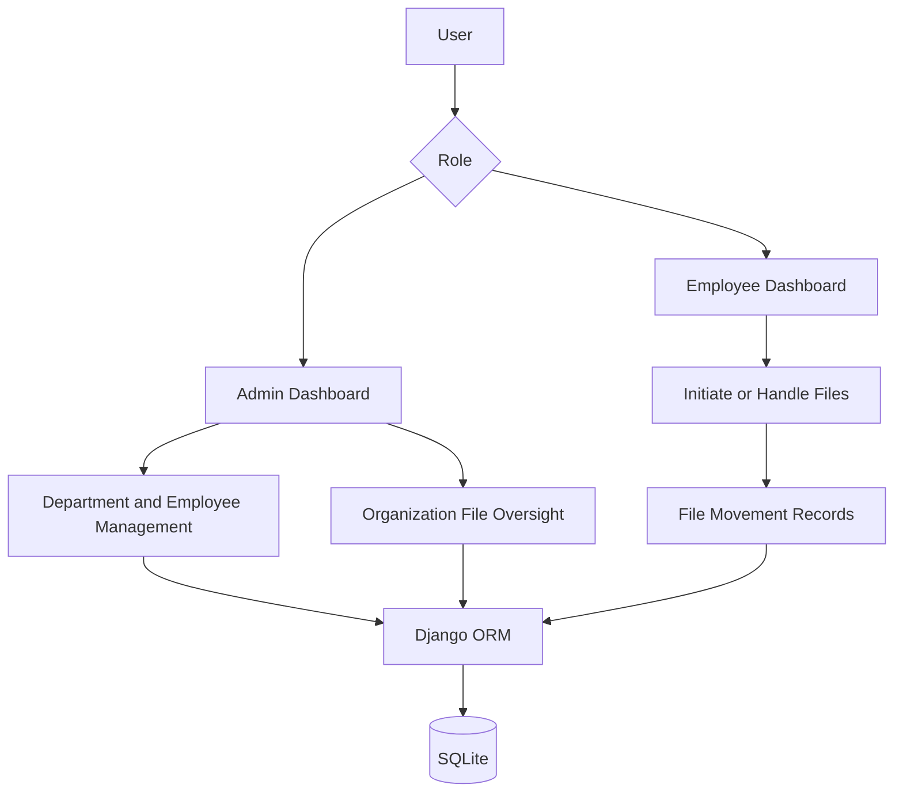

<div align="center">

# 📁 FTS — File Tracking System

### A Django-powered platform for managing and tracking organizational file movement

[](https://www.python.org/)
[](https://www.djangoproject.com/)
[](https://www.sqlite.org/)
[](https://github.com/AdityaGit8009/FTS)

**[Explore the Code](https://github.com/AdityaGit8009/FTS)** · **[Report an Issue](https://github.com/AdityaGit8009/FTS/issues)** · **[Developer Profile](https://github.com/AdityaGit8009)**

</div>

---

## 📖 Overview

**FTS (File Tracking System)** is a web application built with **Python and Django** to help organizations maintain visibility over files and their movement between employees. Instead of relying on informal hand-offs, the application records who initiated a file, who currently holds it, its status and priority, and the history of its movement.

The project separates administration and employee workflows into dedicated dashboards.

> **Project status:** A working codebase intended for development and demonstration. It requires security hardening and deployment configuration before production use.

## ✨ Core Features

### 🛡️ Administration

- Dashboard showing department, employee, and file counts.
- File status summaries: **Open**, **In Progress**, and **Closed**.
- Department creation, listing, and management.
- Employee registration, profile editing, and account administration.
- Organization-wide file listing and management.
- Recent file activity and department-level employee statistics.

### 👩‍💻 Employee Workspace

- Employee dashboard with assigned, initiated, and recently handled files.
- Initiate files with a title, subject, priority, optional attachment, and recipient.
- Automatically generated file identifiers, such as `FILE-2026-0001`.
- View **pending**, **received**, **initiated**, and **handled** files.
- Forward, return, or close files as part of the movement workflow.
- View movement records, remarks, sender/recipient information, and timestamps.
- Update employee profile details and profile picture.
- Account password-change and password-recovery workflows.

### 📊 Tracking & Accountability

| Capability | Description |
|---|---|
| **Unique File ID** | Automatically generated year-based identifiers |
| **File Status** | Open, In Progress, Closed |
| **Priority** | Low, Medium, High, Urgent |
| **Current Holder** | Tracks the employee currently holding a file |
| **Movement History** | Records Create, Forward, Return, and Close events |
| **Attachments** | Optional file uploads associated with a record |
| **Dashboard Analytics** | File counts, employee statistics, and recent movements |

## 🧰 Technology Stack

| Layer | Technology |
|---|---|
| Backend | Python, Django 5.2 |
| Database | SQLite (Django ORM) |
| Interface | Django templates and project static assets |
| Authentication | Custom application login and session handling |
| Email | Django email framework (console backend in current settings) |
| File Storage | Django `FileField` and local media directory |

## 🏗️ Application Architecture



## 📂 Project Structure

```text
FTS/
├── adminapp/               # Administration views and related assets
├── empapp/                 # Employee workflows and views
├── ftsproject/             # Django project configuration
│   ├── settings.py
│   ├── urls.py
│   ├── asgi.py
│   └── wsgi.py
├── mainapp/                # Shared models, login, landing pages
├── media/
│   └── attachments/        # Uploaded file attachments
├── db.sqlite3              # Local development database
└── manage.py               # Django management entry point
```

## 🚀 Getting Started

### 1. Prerequisites

- Python 3.10 or newer (a compatible Python 3 release)
- Git
- pip

### 2. Clone the repository

```bash
git clone https://github.com/AdityaGit8009/FTS.git
cd FTS
```

### 3. Create and activate a virtual environment

**Windows (PowerShell):**

```powershell
python -m venv .venv
.venv\Scripts\Activate.ps1
```

**Linux / macOS:**

```bash
python3 -m venv .venv
source .venv/bin/activate
```

### 4. Install dependencies

The repository does not currently include a dependency lockfile or `requirements.txt` at its root. Install the framework and image-handling dependency:

```bash
python -m pip install "Django>=5.2,<5.3" Pillow
```

### 5. Prepare the database

```bash
python manage.py migrate
```

> The repository already contains a development SQLite database. For a fresh environment, use a new local database and provide your own test users rather than relying on any checked-in account records.

### 6. Run the development server

```bash
python manage.py runserver
```

Visit **http://127.0.0.1:8000/**.

**Application entry points:**

| Page | Local URL |
|---|---|
| Home | `http://127.0.0.1:8000/` |
| Admin login | `http://127.0.0.1:8000/adminlogin/` |
| Employee login | `http://127.0.0.1:8000/userlogin/` |
| Django admin | `http://127.0.0.1:8000/admin/` |

> **Note:** Creating a Django superuser with `createsuperuser` does **not** automatically create a user in the project's custom `LoginInfo` model. The custom admin and employee login pages use that separate model.

## 🔄 Typical File Lifecycle

1. **Initiate:** An employee creates a file and optionally attaches a document.
2. **Assign:** The file is assigned to another employee (or initially retained by its creator).
3. **Process:** The current holder reviews the file and may forward or return it with remarks.
4. **Track:** The application records file movements and keeps the current holder visible.
5. **Close:** The file can be marked closed, retaining its movement history.

The application uses the following file priorities and statuses:

- **Priorities:** `LOW`, `MEDIUM`, `HIGH`, `URGENT`
- **Statuses:** `OPEN`, `IN_PROGRESS`, `CLOSED`
- **Movement actions:** `CREATE`, `FORWARD`, `RETURN`, `CLOSE`

## 🔐 Security & Production Readiness

**Important:** The current repository is **not production-ready**. Before deploying it publicly or storing real employee information, address these issues:

- Replace the exposed Django `SECRET_KEY`, move secrets to environment variables, and disable `DEBUG` in production.
- Replace custom plaintext password storage and comparison with Django's supported password hashing and authentication system.
- Remove predictable default passwords and avoid sending passwords via email.
- Harden password-reset flows using secure random tokens, rate limiting, and account verification.
- Configure `ALLOWED_HOSTS`, HTTPS, secure cookies, and a real transactional email service.
- Audit permissions for every file view and action to ensure users only access authorized records.
- Validate uploaded files and restrict their type, size, location, and access.
- Remove real or sensitive records from the committed SQLite database and uploaded media; rotate any exposed credentials.
- Run `python manage.py check --deploy` and perform security testing before release.

The configured email backend currently prints messages to the development console; it does **not** deliver OTP messages to real email inboxes.

## 🗺️ Potential Enhancements

- [ ] Replace custom login with Django's built-in authentication and role permissions.
- [ ] Add searchable, filterable, paginated file listings.
- [ ] Add file-processing notifications and reminders.
- [ ] Build exportable audit and analytics reports.
- [ ] Add automated tests and continuous integration.
- [ ] Add production deployment configuration and environment-based settings.
- [ ] Introduce API endpoints for integration with external systems.

## 🤝 Contributing

Suggestions and improvements are welcome. To contribute, fork the repository, create a feature branch, commit your changes, and open a pull request.

Please avoid including real employee information, secrets, or private uploaded documents in issues and pull requests.

## 👨‍💻 Developer

**Aditya Pratap Vishwakarma**

- 🌐 [GitHub](https://github.com/AdityaGit8009)
- 💼 [LinkedIn](https://www.linkedin.com/in/vish-aditya/)
- 📧 [Email](mailto:adityapratap7391@gmail.com)

---

<div align="center">

**FTS — Making organizational file movement easier to follow.**

⭐ If you find this project useful, consider starring the repository.

</div>
